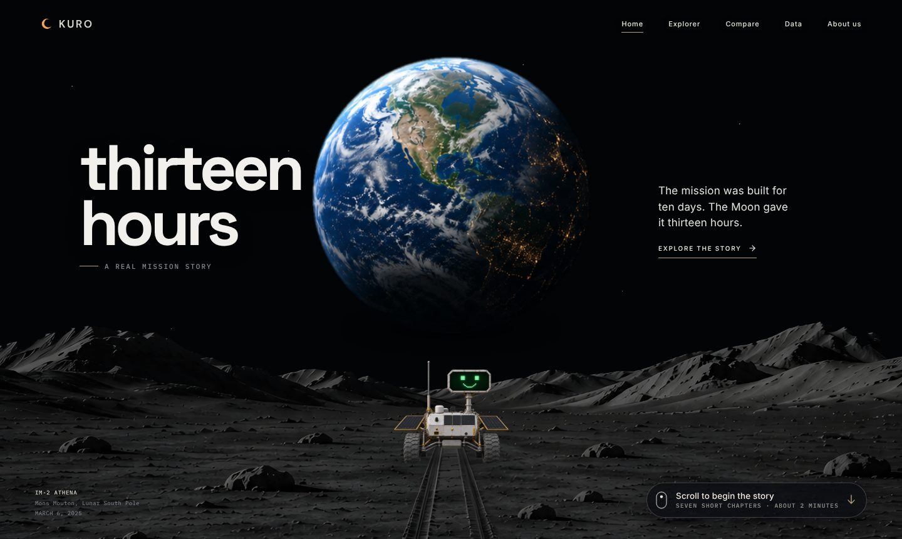
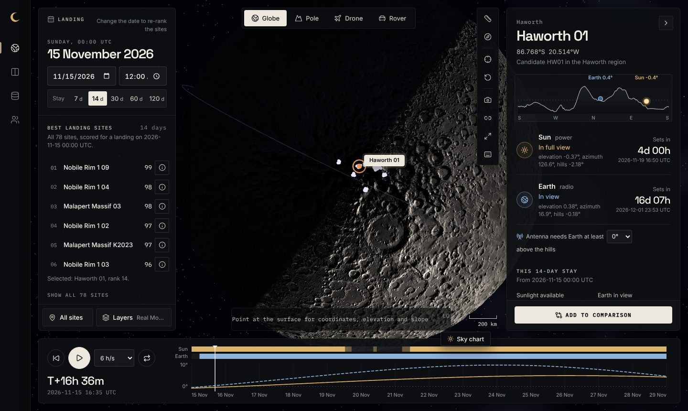
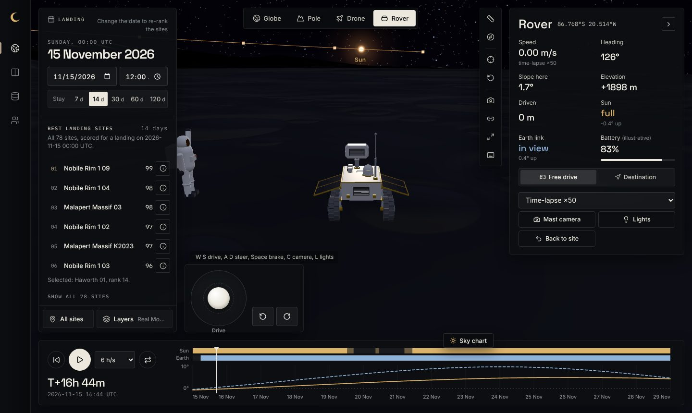
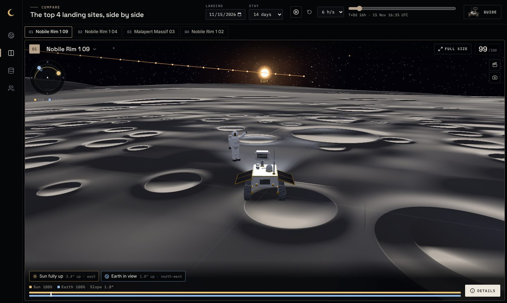

# KURO · Lunar South Pole Navigator

**NASA Space Apps Challenge 2026 · Challenge: Lunar Landing Site Navigator · Team: The Selenites**

Pick a landing date and KURO ranks 78 candidate landing sites near the Moon's South Pole by sunlight, Earth contact and terrain. It explains every result in plain words, lets you explore each site in 3D on real NASA terrain, and puts the best sites side by side.



## The problem

At the lunar South Pole the Sun skims the horizon and Earth hangs low in the sky, so a few metres of terrain decide whether a lander has power and whether it can call home. In March 2025, IM-2 Athena came to rest on its side in a shadowed crater near Mons Mouton. It was planned for about 10 days on the surface and lasted less than 13 hours once its solar panels could not recharge its batteries.

The Space Apps challenge *Lunar Landing Site Navigator* notes that tools for Sun and Earth positions exist but are hard to use. It asks for an intuitive tool that lets mission planners, educators and the public compare landing sites and dates, seeing the Sun and Earth against the horizon to judge solar power and direct-to-Earth communication.

## Our solution

| | |
|---|---|
| **Rank** | Choose a landing date, time and stay (7 to 120 days); all 78 sites in 9 South Pole regions are scored out of 100 in under a second |
| **Explain** | Sun and Earth plotted on each site's real skyline, with every reason written in plain words from the site's own numbers |
| **Explore** | Globe, Pole, Drone and Rover views on NASA LOLA terrain, with the true Sun and Earth paths in the sky |
| **Compare** | The best four sites as live rover views on one shared clock |
| **Trust** | Sun and Earth checked against NASA JPL Horizons to within 0.02° (worst case 0.0071°); 148 automated tests |



## Pages

| Page | What it does |
|---|---|
| **Home** | *Thirteen Hours*: the story of IM-2 Athena in seven chapters, one per scroll, told by the KURO rover |
| **Explorer** | 3D Moon. Pick a landing date and see the 78 sites ranked; open any site's details, or fly down and drive the rover there. Views: Globe, Pole, Drone, Rover. Includes a plain-language guide and a hideable rover panel |
| **Compare** | The top four sites side by side as live rover views on one shared clock, with sky maps, score breakdowns and a details dialog |
| **Data** | Every NASA source KURO uses, and a live re-check against JPL Horizons in your browser |
| **About us** | The team and the project |





## How it works

1. **Sun and Earth positions** come from NASA JPL DE421, with lunar librations, in the MOON_ME frame, from 1966 to 2049. `pipeline/ephemeris/build_ephemeris.py` pre-computes them into `public/data/ephemeris.bin`, and the browser interpolates them without extrapolating.
2. **Skylines** are traced for each site in 360 directions out to 300 km over NASA LOLA elevation, including the Moon's curvature, from an eye height of 2 m. All 78 sites ship pre-traced in `src/data/site-horizons.json`, identical to a live trace.
3. **Visibility:** the Sun counts as visible when its centre clears the skyline. Earth counts as in view when it clears the skyline plus an optional antenna margin (0° to 10°). Each stay is sampled about every 15 minutes.
4. **Slope** comes from the LOLA South Pole DEM (PGDA product 90, 80 m grid).
5. **Score:** the KURO backend's formula, reproduced exactly in `src/services/backendScore.ts`. A site that never sees the Sun, or never sees Earth, scores 0.

| Part | Weight | Measures |
|---|---|---|
| Flat ground | 25% | Slope and roughness |
| Safety | 25% | Slope, roughness, hazards, longest darkness, longest radio gap |
| Sunlight | 20% | Share of the stay with the Sun's centre above the skyline |
| Earth link | 15% | Share of the stay with Earth in view |
| Sun + Earth | 15% | Share of the stay with power and radio at once |

Missing inputs are scaled down rather than guessed: roughness needs terrain finer than 40 m, and no hazard map exists yet.

## Validation

| Check | Result |
|---|---|
| Sun and Earth vs NASA JPL Horizons (1,440 directions, 10 sites) | Largest difference 0.0071°; tests fail above 0.02° |
| Ephemeris interpolation vs direct DE421 | ≤ 0.0012° Sun, ≤ 0.0004° Earth |
| Apollo 11 landing Sun angle | 10.7° (record ≈ 10.8°) |
| Illumination at the Shackleton rim ridge, 2020 | 86% vs 85.5% published (Gläser et al. 2018) |
| Permanently shadowed crater floors (Shackleton, Haworth, Malapert) | Dark all year |
| Ranking vs the KURO backend's Python | Identical scores |

## NASA data and tools

| Resource | Used for |
|---|---|
| **NASA JPL DE421** ephemeris | Sun and Earth positions, 1966 to 2049 |
| **NASA JPL Horizons** | Independent reference for every Sun and Earth direction; linked from each site |
| **LOLA South Pole DEM**, NASA GSFC PGDA product 90 (Barker et al. 2023) | Terrain, slope and skylines, 80 m core |
| **LOLA LDEM_16**, NASA PDS Geosciences Node | Whole-Moon globe and distant hills |
| **LRO WAC mosaic** via **NASA Moon Trek** | Surface imagery; the permanently shadowed regions layer |
| **LROC QuickMap** (Arizona State University) | Sharpest LRO imagery, linked from each site |
| **Artemis III candidate regions** (NASA) | The 9 regions grouping the 78 sites |
| **CGI Moon Kit**, NASA Scientific Visualization Studio | Global elevation and colour sources |

## Run it

Needs Node 20.19 or newer. The NASA data is already in `public/`, and no API keys are needed.

```
npm install
npm run dev             # http://localhost:5173
```

```
npm test                # maths, data and ranking checks
npm run build           # type-check, then the static site in dist/
npm run preview         # serve dist/ locally
npm run fetch:moon      # re-download and pack NASA LOLA + LRO data
npm run build:horizons  # re-trace the 78 site skylines
```

## Deploy

The build is a static site with hash routes (`#/explorer`), so any static host works without rewrite rules.

- **Vercel:** import the repository. `vercel.json` already sets the build command, the `dist/` output, and long caching for data files.
- **Netlify, GitHub Pages, Cloudflare Pages:** build command `npm run build`, publish directory `dist`.

To use the KURO backend, set `VITE_API_BASE`. Leave it unset to compute everything in the browser. The request and response shapes are documented in `src/services/api.ts`.

## Tech stack

React 19 · TypeScript · Three.js · Zustand · GSAP · Vite · Vitest · Python (offline ephemeris pipeline)

## Project layout

```
src/explorer/         Explorer page, Moon data loader, horizon tracing, slope
src/explorer/engine/  Three.js engine: globe, terrain and visibility, sky, rover, terrain worker
src/engine/           time scales, ephemeris interpolation, sky geometry, events, explanations
src/services/         API layer and the ranking formula
src/data/             the 78 candidate sites, pre-traced skylines, JPL Horizons reference set
src/pages/            Home, Compare, Data, About us
src/components/       shared interface parts: guides, ranking, timelines, site details
scripts/              NASA data download and lossless packing
pipeline/             offline Python for the ephemeris table
```

## Limitations

KURO is a planning and teaching aid, not a certified mission tool.

- Terrain is 80 m at best, so boulders and small craters are not resolved.
- There is no roughness or hazard map yet.
- "Earth in view" is line-of-sight geometry, not a guaranteed radio link.
- Dates are limited to 1966–2049.
- KURO does not claim it would have prevented the Athena or Odysseus outcomes. The KURO rover is an illustrative guide, not a mission vehicle.

## Use of AI assistance

During the hackathon we used AI tools to speed up our work. Every design choice, scientific decision and final result remained our own.

- **Code:** written and refactored with Claude (Anthropic) and Codex (OpenAI). Every change was reviewed by the team and had to pass the automated tests.
- **Research:** ChatGPT and Perplexity helped with background reading and finding sources. Facts were checked against the original sources.
- **Visuals:** early concept images were explored with ChatGPT and Gemini, and the project video was produced with Google Flow.
- **Documentation:** Claude helped draft and structure the documentation, and Miro AI gave inspiration for the flowchart layouts.

No scientific result in KURO was generated by AI. Every Sun and Earth position, skyline, slope and score is computed by KURO's own engine from NASA data, and checked against NASA JPL Horizons and published studies.

## Team

Built by **The Selenites** for the NASA Space Apps Challenge 2026.

---

Not affiliated with or endorsed by NASA. Credit: NASA/JPL, NASA GSFC LOLA team and PGDA, NASA PDS Geosciences Node, NASA Scientific Visualization Studio, NASA Solar System Treks, LROC/Arizona State University.
